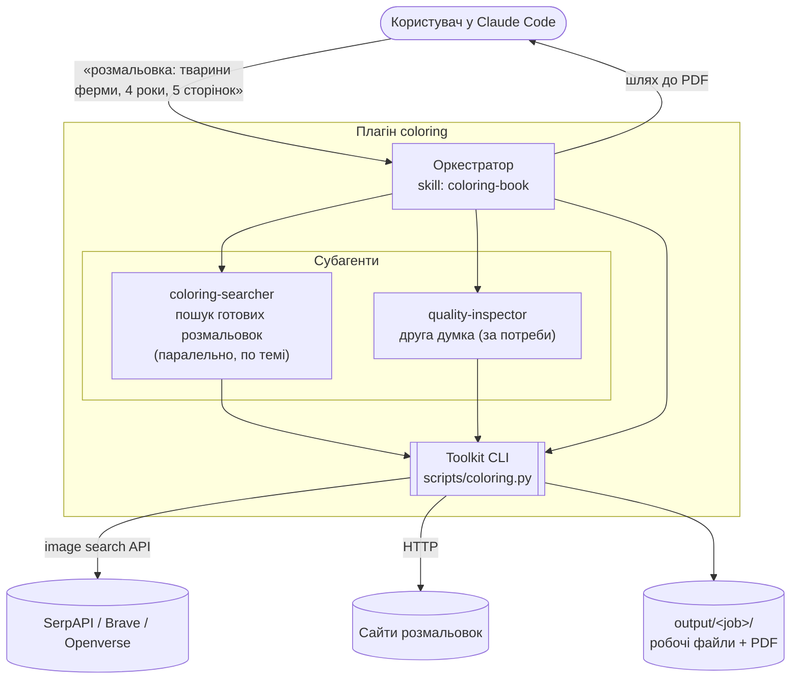
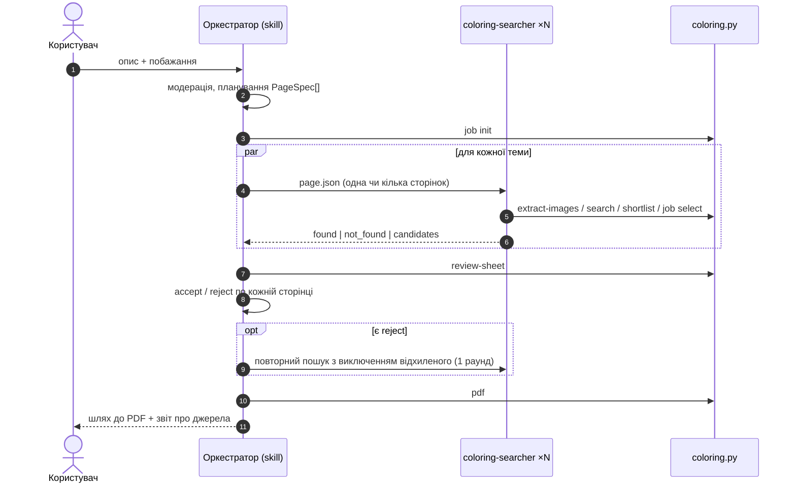
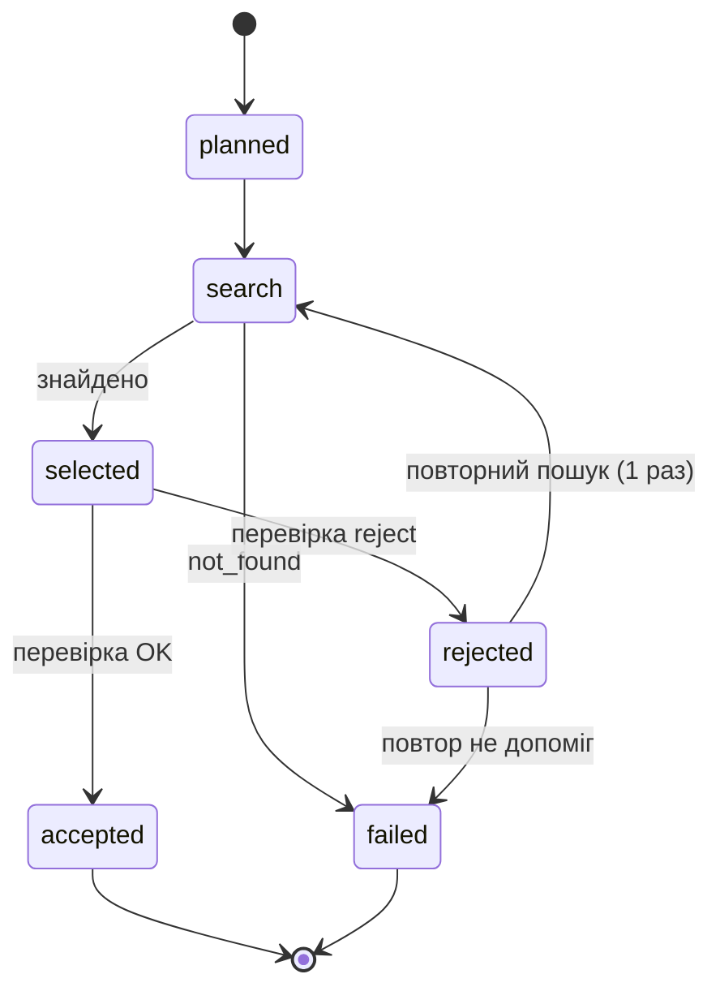

# Архітектура: пошук розмальовок (Claude Code plugin)

> Статус: **v0.5** · Аудиторія документа: розробники плагіна

## 1. Мета

Користувач у Claude Code описує, яку розмальовку хоче отримати. Плагін **знаходить готові розмальовки** в інтернеті й повертає PDF формату **A4**: одну сторінку або кілька.

Плагін нічого не малює сам: немає ні генерації зображень, ні перетворення фото чи кліпарту на контурний малюнок. Знайдена розмальовка лише очищується (обрізання полів і рамки, видалення сірих заливок, потовщення надто тонких ліній) і верстається в PDF.

## 2. Зафіксовані вимоги

| # | Питання | Рішення |
|---|---------|---------|
| R1 | Аудиторія | **Діти та батьки**. Жорстка модерація контенту, рівні складності за віком |
| R2 | Інтерфейс | **Claude Skill / плагін для Claude Code**. Окремого бекенда немає |
| R3 | «Кілька сторінок» | **N варіантів однієї теми** і **набір за темою** (Claude сам розбиває тему на сторінки) |
| R4 | Ліцензії | **Особисте використання**, джерела будь-які. Джерело кожної сторінки фіксується й друкується в PDF |
| R5 | Джерело зображень | **Лише пошук готових розмальовок.** Генерації та конвертації немає. Якщо для сторінки нічого не знайдено, вона `failed`, а користувач отримує пояснення |
| R6 | Середовище | **Claude Code** (повний доступ до мережі й файлової системи) |
| R7 | Збереження | **Тільки PDF і робочі файли в папці**. Бібліотеки для повторного використання немає |

### Припущення (вподобань не висловлено, прийнято за замовчуванням)

| # | Припущення |
|---|-----------|
| A1 | Параметри витягуються з природної мови: вік/складність, кількість сторінок, підписи, орієнтація |
| A2 | Ліміт: **10 сторінок** на запит, за замовчуванням 1 |
| A3 | Складність за замовчуванням `medium` (6–8 років) |
| A4 | Орієнтація визначається автоматично за пропорціями зображення |
| A5 | Підпис під малюнком мовою запиту вмикається за бажанням. Для наборів обкладинка вмикається за замовчуванням |
| A6 | Мова запиту будь-яка. Пошукові запити пишуться **англійською** |
| A7 | Пошук іде через сайти розмальовок (WebSearch → `extract-images`) та **API пошуку картинок** (SerpAPI, Brave, Openverse) з **SafeSearch = strict** |

## 3. Огляд архітектури

Плагін складається з трьох шарів:

1. **Оркестратор** (skill `coloring-book`). Працює в головній сесії Claude: планує сторінки, запускає пошук паралельно, перевіряє результат, збирає PDF.
2. **Субагенти** (`agents/*.md`) з ізольованим контекстом. Важкі зображення не потрапляють у контекст головної сесії.
3. **Toolkit** (Python CLI `scripts/coloring.py`). Детерміновані операції: пошук через API, завантаження, метрики зображень, очищення line-art, верстка PDF.



### Чому саме так

- **Головна сесія лише оркеструє.** У Claude Code субагенти не можуть запускати інших субагентів, тому весь контроль потоку живе в skill.
- **Один субагент на тему.** Сторінки обробляються паралельно. Перегляд кандидатів (vision) відбувається в ізольованому контексті субагента, а наверх повертається лише короткий JSON-результат.
- **Скрипти для детермінованої роботи, LLM для оцінки.** Метрики пікселів, бінаризація й верстка дешеві та відтворювані. LLM потрібна там, де є судження: чи відповідає картинка опису, чи вона безпечна, чи гарна як розмальовка.
- **Файли як контракт.** Агенти обмінюються даними через `page.json` у робочій папці, а не через контекст. Кожна сторінка має власний файл, тому немає гонок при паралельному записі.

## 4. Компоненти

### 4.1 Оркестратор: skill `coloring-book`

Файл: `skills/coloring-book/SKILL.md`. Відповідає за:

1. **Модерацію запиту** (R1). Неприйнятні для дітей теми відхиляються або м'яко переформульовуються.
2. **Планування.** Розбирає запит у `JobSpec` і список `PageSpec` (див. §6).
3. **Створення робочої папки** (`coloring.py job init`).
4. **Пошук** через `coloring-searcher` для всіх сторінок паралельно (§5).
5. **Фінальну перевірку** за `review-sheet`. Відхилені сторінки отримують один повторний пошук.
6. **Верстку PDF** (`coloring.py pdf`) і звіт користувачу: шлях до PDF, джерело кожної сторінки, що не знайшлося.

Модель успадковується від сесії.

### 4.2 Субагенти

| Агент | Модель | Інструменти | Вхід | Вихід |
|-------|--------|-------------|------|-------|
| `coloring-searcher` | `sonnet` | Bash, Read, WebSearch, WebFetch | `page.json` (один або кілька однієї теми) | `search` у `page.json`: обраний файл, `candidates` або `not_found` |
| `quality-inspector` | `sonnet` | Bash, Read | усі `page.json` | вердикт по кожній сторінці: `accept` / `reject` + причина |

- **coloring-searcher.** Шукає сайти розмальовок через WebSearch, дістає з них картинки (`extract-images`), за наявності ключів додає результати API (`search`). `shortlist` завантажує, аналізує, відсіює не-line-art і будує нумеровану таблицю; агент дивиться на неї один раз і обирає (`job select`). Обраний файл очищується (`lineart`: бінаризація, обрізання полів і рамки, видалення дрібного сміття й сірих заливок).
- **quality-inspector.** Незалежна перевірка для великих книг (понад 9 сторінок) або коли оркестратору потрібна друга думка.

### 4.3 Toolkit: `scripts/coloring.py`

Єдиний CLI з підкомандами. Кожна команда друкує JSON у stdout.

| Команда | Призначення |
|---------|-------------|
| `job init --spec spec.json` | Створює `output/<job-id>/`, `job.json`, `pages/NN/page.json` |
| `job select --page P --n N [--source shortlist\|candidates]` | Робить кандидата N фінальним: очищує його в `final.png`, записує джерело й pHash |
| `job verdict --page P --accept\|--reject` | Записує рішення фінальної перевірки |
| `job stop --job DIR --reason R --pages ...` | Зупиняє завдання без PDF (нічого не знайдено) |
| `search --query Q --limit N --out F` | Пошук картинок через провайдерів (SafeSearch strict, фільтр line art там, де він є) |
| `extract-images --page-url URL --out F` | Дістає картинки зі сторінки сайту: `og:image`, прямі посилання на файли, `` (з `srcset`, lazy-атрибутами, Next.js-проксі), відкидає іконки й логотипи |
| `fetch --candidates LIST.json \| --url U... --out DIR` | Паралельне завантаження з перевірками (формат, розмір, мінімальна роздільність, заблоковані домени) і відсіюванням майже-дублікатів за pHash |
| `shortlist --page P --candidates F... [--match W...]` | Завантаження + аналіз + фільтр + ранжування + нумерована таблиця в один виклик |
| `candidates --page P --keep N,N,...` | Режим показу: `candidates.json` і таблиця для користувача з номерів шортлиста |
| `sheet --page P` | Таблиця з `candidates.json` (REF + номери) |
| `review-sheet --job DIR` | Одне зображення з усіма фінальними сторінками та еталонами + рядок метрик |
| `analyze --dir DIR \| --image F...` | Метрики: `lineart_score`, частки кольору/сірого/суцільних заливок, товщина ліній, замкнені області, `text_likelihood`, pHash |
| `lineart --image F --out F --profile P` | Очищення знайденої розмальовки в чистий чорно-білий контур друкарського розміру |
| `thumb --image F` | Зменшена копія для перегляду vision |
| `config get KEY` | Значення з ефективної конфігурації |
| `pdf --job DIR` | Верстка A4 PDF з фінальних PNG (§9) |

Провайдери пошуку винесені за інтерфейс:

```python
class ImageSearchProvider(Protocol):
    def search(self, query: str, limit: int, safe: bool = True) -> list[Candidate]: ...
```

Реалізації: `serpapi`, `brave`, `openverse` (без ключа, fallback). Порядок задається в `config.yaml`.

Особливості пошуку (перевірено на реальних даних):

- **SerpAPI** використовує фільтр типу Google Images `itp:lineart`.
- **Openverse** не потребує ключа, але готових розмальовок у ньому мало.
- Найкраще працюють **сайти розмальовок** (WebSearch → `extract-images`): вони віддають чисті контурні малюнки 600–1000 px.

## 5. Потік обробки

### 5.1 Пошук з паралельністю по темах



### 5.2 Стани сторінки



Сторінка у стані `failed` не блокує PDF. Користувач отримує частковий результат і пояснення. Якщо не знайдено жодної сторінки, оркестратор викликає `coloring.py job stop --reason nothing_found --pages ...`, не збирає PDF і пропонує змінити або спростити тему. Знайдені кандидати лишаються в робочій папці.

### 5.3 Відомі персонажі та показ кандидатів

Сайти з фанатськими розмальовками підписують малюнок іменем персонажа, навіть коли він на персонажа не схожий. Тому:

- **Еталон.** Якщо тема — конкретний персонаж (поле `character` у `PageSpec`), пошуковий агент спершу знаходить його офіційне зображення (фан-вікі, сайт студії), зберігає його як `ref/ref.png` і описує впізнавані риси в `ref/notes.md`. Кожного кандидата він порівнює з еталоном і оцінює схожість (`high` / `medium` / `low`); `low` ніколи не приймається.
- **Показ кандидатів** (`preview: true`). Вмикається, коли користувач просить «спочатку покажи» або відхилив готову сторінку. Агент нічого не обирає: `coloring.py candidates` пише `candidates.json` і будує таблицю (еталон REF і пронумеровані кандидати). Оркестратор показує її користувачу і чекає на вибір, а `coloring.py job select --n N` очищає обраний малюнок у `final.png` (попередній зберігається як `previous_final_K.png`). Сторінку, обрану користувачем, перевірка не відхиляє через схожість чи смак, лише через жорсткі проблеми (безпека, текст, сірі заливки).

Формат і правила описані в `skills/coloring-book/reference/characters-and-preview.md`.

## 6. Планування запиту

Оркестратор перетворює запит на `JobSpec`:

```json
{
  "request": "розмальовка тварини ферми для 4-річної, 5 сторінок, з підписами",
  "language": "uk",
  "mode": "set",               // "variants" | "set"
  "difficulty": "easy",        // easy | medium | hard
  "captions": true,
  "cover": true,
  "pages": [
    { "n": 1, "subject": "cow",     "caption": "Корова",  "query_hints": ["cartoon cow", "cow farm"] },
    { "n": 2, "subject": "pig",     "caption": "Свинка",  "query_hints": ["cute pig"] },
    { "n": 3, "subject": "duck",    "caption": "Качечка", "query_hints": [] },
    { "n": 4, "subject": "horse",   "caption": "Конячка", "query_hints": [] },
    { "n": 5, "subject": "chicken", "caption": "Курочка", "query_hints": [] }
  ]
}
```

Режими:

- **`variants`** («3 розмальовки з єдинорогом»). Усі сторінки мають однаковий `subject` і йдуть одному агенту: один пошук, різні картинки (дублікати відсіюються за pHash).
- **`set`** («тварини ферми»). Оркестратор сам обирає N конкретних, легко впізнаваних для дитини об'єктів.

Профілі складності (використовуються в `analyze` і `lineart`):

| Профіль | Вік | Товщина лінії @300dpi | Кількість замкнених областей | Деталі |
|---------|-----|-----------------------|------------------------------|---------|
| `easy` | 3–5 | 8–14 px | ≤ 40 | один великий об'єкт, без фону |
| `medium` | 6–8 | 5–8 px | 30–150 | об'єкт + простий фон |
| `hard` | 9–12 | 3–5 px | 100–400 | детальна сцена, візерунки |

## 7. Пошук і очищення

1. WebSearch `"<subject> coloring page printable"` (+ `query_hints`), 2–4 сайти розмальовок → `extract-images`. За наявності ключів додатково `search`.
2. **Автоматичний фільтр** (`shortlist`, без LLM): `lineart_score ≥ 0.7`, роздільність не нижча за 500 px по короткій стороні, немає великих кольорових чи сірих заливок; дублікати й виключені хеші відкидаються. Штраф у ранжуванні за ймовірний текст чи водяний знак.
3. **Vision-оцінка** однієї нумерованої таблиці: відповідність опису, складність під профіль, відсутність водяних знаків і тексту, безпека, схожість на еталон для персонажів.
4. **Очищення** обраного (`lineart`):
   ```
   обрізання до вмісту → обрізання всередині рамки сторінки (разом із підписами сайту)
   → масштаб до друку → чорнило = темні пікселі + межі сірих заливок
   → видалення дрібних компонент → великі суцільні чорні заливки стають контурами
   → надто тонкі лінії потовщуються (товсті лишаються як у художника)
   → закриття дрібних розривів
   ```

## 8. Контроль якості

Двоступенева перевірка: спершу **дешеві метрики** відсіюють більшість кандидатів, а **vision-LLM** дивиться лише на таблицю найкращих.

Критерії прийняття фінальної сторінки (`skills/coloring-book/reference/quality-criteria.md`):

1. Чисто чорні лінії на чисто білому тлі, без сірого, заливок і штрихування.
2. Більшість областей замкнені, тож їх можна розфарбувати.
3. Товщина ліній і кількість областей відповідають профілю складності.
4. Об'єкт однозначно впізнається й відповідає `subject`.
5. Немає тексту, водяних знаків, логотипів, рамок і обрізаних частин об'єкта.
6. Контент безпечний для дітей: без насильства, страшних образів, неприйнятних символів.
7. Для `variants` сторінки помітно різні, для `set` близькі за стилем і складністю.

Фінальну перевірку робить оркестратор за `review-sheet` і записує рішення через `job verdict`. `quality-inspector` повертає `[{"page": n, "verdict": "accept"|"reject", "score": 0-10, "reasons": [...]}]`.

## 9. Верстка PDF

- A4 210×297 мм, **300 DPI** (2480×3508 px), поля 10 мм.
- Орієнтація кожної сторінки обирається за пропорцією зображення, або фіксована, якщо користувач попросив.
- Зображення вписується в робочу область зі збереженням пропорцій і центрується.
- Опційний підпис: великий контурний шрифт унизу, мовою запиту.
- Опційна обкладинка для набору: назва та мініатюри.
- Колонтитул дрібним сірим шрифтом: `Джерело: <домен>` (R4).
- Бібліотеки: `Pillow` (растр) + `reportlab` (векторний текст). Шрифт DejaVu Sans Bold із кирилицею вкладено в плагін (`assets/fonts/`).

## 10. Робоча папка та контракти даних

```
output/
└── 2026-10-03_farm-animals_a1b2/
    ├── job.json                 # JobSpec + підсумковий статус
    ├── pages/
    │   ├── 01/
    │   │   ├── page.json        # PageSpec + історія пошуку + фінальний вибір
    │   │   ├── candidates/      # завантажені оригінали
    │   │   ├── shortlist.json   # відфільтровані й пронумеровані кандидати
    │   │   ├── shortlist_sheet.png
    │   │   └── final.png        # очищений line-art, готовий до верстки
    │   └── 02/ ...
    ├── report.md                # людиночитний звіт (джерела, відмови)
    └── farm-animals.pdf         # результат
```

`page.json` (скорочено):

```json
{
  "n": 1,
  "subject": "cow",
  "caption": "Корова",
  "difficulty": "easy",
  "status": "accepted",
  "search": { "status": "found", "chosen": 2, "chosen_from": "shortlist.json", "notes": "" },
  "final": {
    "path": "final.png",
    "origin": "found",
    "source_url": "https://example.org/cow.png",
    "source_page": "https://example.org/cow",
    "phash": "c3c3..."
  },
  "inspection": { "verdict": "accept", "score": 8, "reasons": [] }
}
```

Правило запису: субагент пише **лише** `pages/<свій NN>/`, а `job.json` оновлює тільки оркестратор (через `coloring.py`).

## 11. Безпека для дітей

1. **Запит.** Оркестратор відхиляє неприйнятні теми.
2. **Пошук.** SafeSearch strict у провайдерах, а також стоп-лист доменів і слів у `config.yaml`.
3. **Кандидат.** Vision-перевірка безпеки пошуковим агентом.
4. **Фінал.** Перевірка за `review-sheet` має право вето.

## 12. Конфігурація та секрети

- `config.yaml` (поряд зі skill, перевизначається через `~/.config/coloring/config.yaml`): провайдери, пороги метрик, профілі складності, папка `output`.
- Секрети беруться лише зі змінних середовища: `SERPAPI_API_KEY`, `BRAVE_API_KEY`. Відсутній ключ означає, що провайдер пропускається; Openverse і WebSearch працюють без ключів.
- Залежності Python: `requirements.txt` (`requests`, `Pillow`, `numpy`, `opencv-python-headless`, `imagehash`, `reportlab`, `PyYAML`).

## 13. Обробка помилок і деградація

| Ситуація | Поведінка |
|----------|-----------|
| Немає ключа пошуку | Openverse (без ключа) + WebSearch/WebFetch |
| Мережева помилка / 429 | Ретраї з експоненційною затримкою (3 спроби), далі наступний провайдер |
| Завантаження: не картинка / завелика / мала | Кандидат відкидається |
| Для сторінки нічого не знайдено | Сторінка `failed`, звіт пояснює чому й пропонує іншу тему |
| Частина сторінок `failed` | PDF збирається з решти |
| Не знайдено жодної сторінки | `job stop`, PDF не створюється, користувач отримує причини й пропозиції |

## 14. Продуктивність і вартість

- **Паралелізм:** до `max_parallel_agents` (за замовчуванням 5) пошукових агентів одночасно.
- **Метрики до vision:** агент бачить одну таблицю кандидатів замість окремих мініатюр.
- **`variants`:** один пошук для всіх N сторінок.
- **Пошук в один виклик:** `shortlist` робить завантаження, відсів, аналіз, ранжування й таблицю; `--match` відсіює зайвих персонажів ще до завантаження.
- **Короткий вивід:** `search`/`extract-images --out` пишуть список у файл і друкують лише кількість; агенти повертають лише JSON-рядки.
- **Фінальна перевірка без окремого агента:** `review-sheet` — одне зображення на всю книгу.

## 15. Структура плагіна

```
coloring/
├── .claude-plugin/
│   ├── plugin.json              # маніфест плагіна
│   └── marketplace.json         # дозволяє /plugin install з цього репо
├── agents/
│   ├── coloring-searcher.md
│   └── quality-inspector.md
├── skills/
│   └── coloring-book/
│       ├── SKILL.md             # оркестратор
│       ├── config.yaml
│       ├── reference/
│       │   ├── quality-criteria.md
│       │   ├── difficulty-profiles.md
│       │   ├── characters-and-preview.md
│       │   └── page-schema.md
│       └── scripts/
│           ├── coloring.py      # CLI-точка входу
│           ├── requirements.txt
│           └── coloring_kit/
│               ├── config.py
│               ├── models.py    # JobSpec, PageSpec, Candidate
│               ├── job.py
│               ├── search/      # провайдери пошуку
│               ├── fetch.py
│               ├── analyze.py
│               ├── shortlist.py
│               ├── preview.py
│               ├── review.py
│               ├── lineart.py   # очищення знайдених розмальовок
│               └── pdf.py
└── docs/
    └── architecture.md
```

## 16. Ризики

| Ризик | Пом'якшення |
|-------|-------------|
| Більшість готових розмальовок мають водяні знаки | Детектор тексту в `analyze`, обрізання рамки з підписами в `lineart`, vision-перевірка |
| Для рідкісної теми чи персонажа немає готових розмальовок | Сторінка `failed` з поясненням; пропозиція ближчої або поширенішої теми |
| Фанатські малюнки не схожі на персонажа | Еталон `ref/ref.png` і обов'язкова перевірка схожості |
| Нестабільність API пошуку | Адаптери + ланцюжок fallback-провайдерів + сайти через WebSearch |
| Сайти блокують завантаження | User-Agent, перехід до наступного кандидата |
